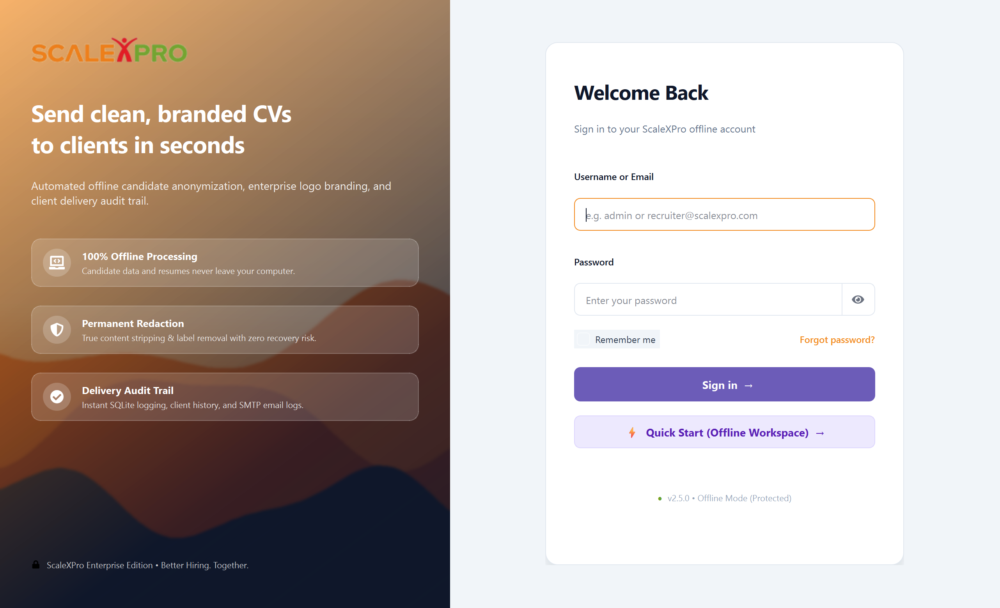
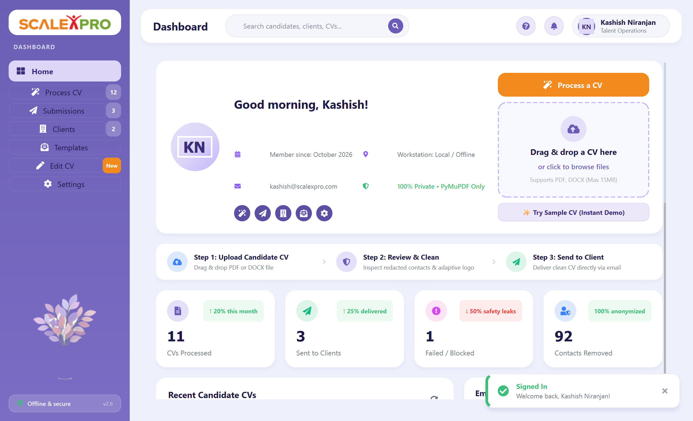
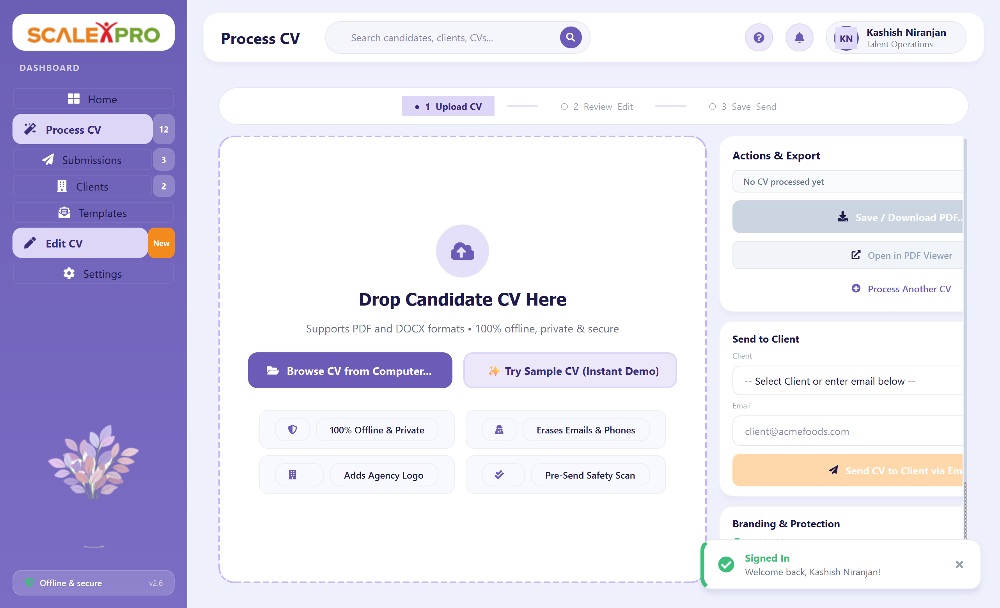
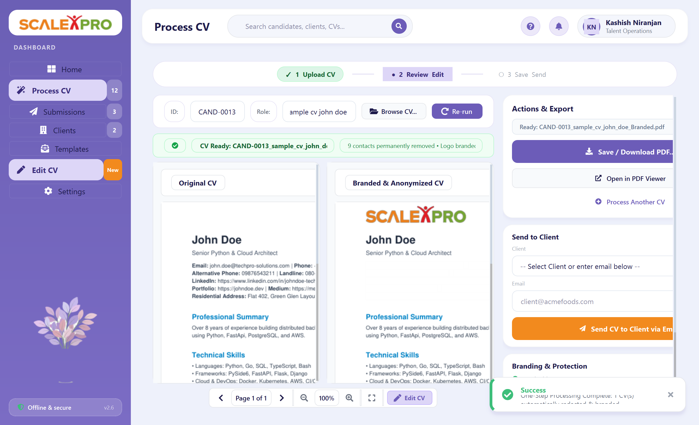
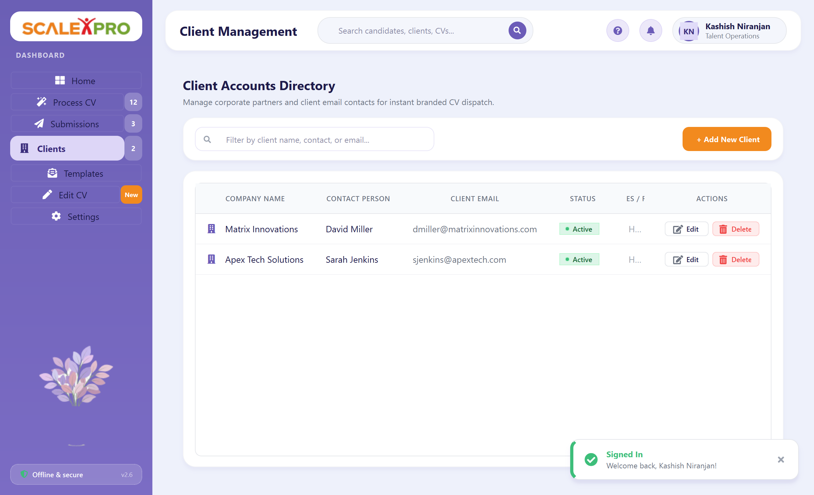
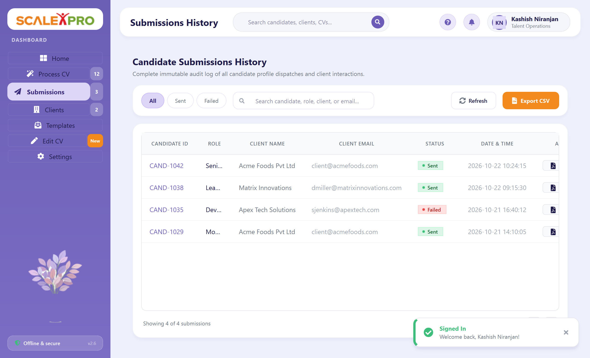

# CV-Modifier — Enterprise Candidate Anonymizer & Brander

A 100% offline, portable Windows desktop application built with Python and PySide6 for recruitment agencies.

**NO AI / LLM or paid APIs anywhere. Everything is free, private, and runs entirely on your local machine.**

---

## 🌟 Key Features

1. **True Redaction (Not just visual covers)**
   - **PDF:** Uses PyMuPDF's true redaction engine (`add_redact_annot` + `apply_redactions`). Underlying text characters and vector paths are permanently erased from the PDF document structure.
   - **DOCX:** Removes sensitive text from paragraphs, table cells, and headers/footers using `python-docx`. Strips `<w:hyperlink>` XML elements and clears document core properties (author, title, comments, company). Converts DOCX to PDF offline.
   - **Clickable Links & Annotations:** Automatically searches for and deletes `mailto:`, `tel:`, and URL link annotations from PDF pages.
   - **Metadata Stripping:** Erases PDF metadata (Author, Title, Producer, Creator, Creation and Modification timestamps).

2. **Rigorous Contact Detection (Indian & International)**
   - **Email Addresses:** Standard emails, subdomains, plus-tagging, obfuscated formats.
   - **Phone Numbers:** Indian formats (`+91`, `91`, `0`, 10-digit mobile starting with 6/7/8/9, space/hyphen separators like `+91 98765 43210` or `98765-43210`), STD landlines (`080-23456789`), and international formats.
   - **URLs & Profiles:** LinkedIn profile links, GitHub URLs, portfolio sites (Vercel, Netlify, GitHub Pages, Medium, Behance, Dribbble, Kaggle, LeetCode).
   - **Physical Addresses:** House/Flat numbers, street lines (Road, Nagar, Colony, Sector, Layout), and 6-digit Indian PIN codes.

3. **Non-Overlapping Company Logo Branding**
   - Place your agency logo (PNG/JPG) at the top of every page of the CV.
   - Automatically detects text boundaries on each page to prevent overlapping existing CV content. If text starts at the very top of the page, the top page margin is safely expanded.

4. **Live Before / After Visual Preview**
   - Side-by-side comparison: **Original CV** vs. **Branded & Anonymized CV**.
   - Synchronized scrolling, page navigation (`Page X of Y`), and zoom controls (Zoom In, Zoom Out, Fit).
   - Full audit trail table listing every detected and removed contact item with category, page number, and original value.

5. **Standardized Export Naming**
   - Automatically exports formatted PDFs named strictly as: `CAND-<id>_<role>.pdf` (for example, `CAND-1001_Python_Developer.pdf`).

6. **Client Email Dispatch with Encrypted Credentials**
   - Send candidate CVs directly to client hiring managers via SMTP (`smtplib`).
   - Supports Gmail with an App Password or custom corporate SMTP servers.
   - **Zero Plain-Text Passwords:** Passwords and tokens are stored encrypted using the system `keyring` service with automatic Windows DPAPI fallback.
   - Customizable email subject and body templates with dynamic tags: `{candidate_id}`, `{role}`, `{candidate_name}`, `{client_name}`, and `{company_name}`.

7. **Final Safety Check (Pre-Send Blocker)**
   - Before any email is dispatched, an independent safety scanner re-scans the rendered output PDF text, links, and annotations.
   - If any email or phone number pattern is still found anywhere in the output PDF, sending is immediately **BLOCKED** and an alert details the exact issue.

8. **Local SQLite Database & Audit History**
   - Stores candidate profiles, client contacts, and submission history in `data/cv_modifier.db`.
   - **History Tab:** Search by candidate ID, role, client name, or email. Filter by status (`SENT` / `FAILED`).
   - **Export to CSV:** Export submission records to CSV with one click.
   - **Open PDF:** Reopen previously exported PDFs directly from the history table.

9. **100% Portable**
   - All runtime data (database, logs, exports, assets) is kept inside a portable `data/` folder next to the executable.
   - Can be run directly from a USB drive or moved between folders without breaking paths.

---

## 📸 Visual Showcase & Workflow

| 1. Frictionless Offline Login | 2. Executive Analytics Dashboard |
|:---:|:---:|
|  |  |

| 3. Instant Dropzone (Empty State) | 4. Side-by-Side Review & Direct Export |
|:---:|:---:|
|  |  |

| 5. Client Directory | 6. Full Audit Submissions |
|:---:|:---:|
|  |  |

---

## 📁 Project Structure

```
CV-Modifier/
├── app/
│   ├── config.py           # Portable paths & default settings
│   ├── logger.py           # Rotating file logger (data/logs/cv_modifier.log)
│   ├── database.py         # SQLite management (candidates, clients, submissions, settings)
│   ├── security.py         # Keyring & Windows DPAPI encrypted credential storage
│   ├── email_service.py    # SMTP email dispatch & connection tester
│   ├── core/
│   │   ├── regex_patterns.py # High-precision regex for emails, phones, URLs, addresses
│   │   ├── pdf_redactor.py   # PyMuPDF true redaction, link deletion, metadata stripping, logo branding
│   │   ├── docx_redactor.py  # python-docx redaction & offline PDF converter
│   │   └── validator.py      # Final safety verification engine
│   └── ui/
│       ├── styles.py         # Modern executive dark-slate QSS theme
│       ├── main_window.py    # Main window with tabs and status bar
│       ├── main_tab.py       # CV Redaction, preview, branding & dispatch workflow
│       ├── preview_widget.py # Synchronized Before/After side-by-side visual viewer
│       ├── redactions_list.py# Audit manifest table of removed items
│       ├── clients_tab.py    # Client account directory
│       ├── history_tab.py    # Submissions audit trail with search, filters & CSV export
│       └── settings_tab.py   # Settings for logo, SMTP, template, and redaction rules
├── tests/
│   ├── test_regex.py       # Unit tests for contact detail detection
│   └── test_redaction.py   # Unit tests for PDF/DOCX redaction & safety verification
├── sample_data/            # Sample CVs (PDF & DOCX) and sample company logo
├── build_portable.py       # One-click PyInstaller build script
├── cv_modifier.spec        # PyInstaller specification file
├── requirements.txt        # All dependencies
├── main.py                 # Application entry point
└── README.md               # User & developer guide
```

---

## 🚀 Quick Start (Running from Python)

### 1. Prerequisites
- Windows 10 or 11
- Python 3.10 to 3.13

### 2. Install Dependencies
```bash
pip install -r requirements.txt
```

### 3. Launch the Application
```bash
python main.py
```

---

## 🧪 Running Unit Tests

Run the complete automated test suite using `pytest`:

```bash
pytest -v
```

This tests:
- Email patterns (standard, subdomains, plus-tags)
- Indian phone formats (`+91`, `0`, 10-digit mobile, STD landlines, spaces, dashes)
- False positive rejection (year ranges `2020-2024`, percentages)
- LinkedIn, GitHub, and portfolio URL patterns
- True PDF redaction (verifies text is deleted from the PDF document structure)
- PDF link deletion and metadata stripping
- DOCX redaction and PDF conversion
- Final safety check verification

---

## 📦 Building the Single Portable `.exe`

To package the entire application into a standalone `.exe`:

```bash
python build_portable.py
```

Or using PyInstaller directly:
```bash
pyinstaller --noconfirm cv_modifier.spec
```

The output executable is created at:
```
dist/CV-Modifier.exe
```

### Portable Deployment
1. Copy `CV-Modifier.exe` to any folder or USB flash drive.
2. When you double-click `CV-Modifier.exe`, it will automatically create and use a `data/` folder right next to it:
   - `data/cv_modifier.db` (SQLite database)
   - `data/logs/cv_modifier.log` (Rotating log files)
   - `data/exports/` (Generated `CAND-<id>_<role>.pdf` files)
   - `data/assets/` (Company logos)

---

## ⚙️ Setting Up Email Dispatch (Gmail SMTP)

1. Open **Settings & Branding** in the app.
2. In the **Email Server Configuration** section:
   - **SMTP Host:** `smtp.gmail.com`
   - **Port:** `587`
   - **Use STARTTLS:** Checked (Enabled)
   - **SMTP Username:** Your agency Gmail or Google Workspace email address.
   - **Password:** Enter a 16-character **Google App Password**.
3. Click **Test SMTP Connection** to confirm connectivity.
4. Click **Save Settings**. Your password is encrypted and saved securely.

> **How to create a Gmail App Password:**
> 1. Go to your [Google Account Security Settings](https://myaccount.google.com/security).
> 2. Ensure **2-Step Verification** is turned ON.
> 3. Search for **App passwords**.
> 4. Create a new App Password named `CV-Modifier` and copy the 16-character code into the application.

---

## 🔒 Privacy & Compliance

- **No Data Leaves Your Computer:** No cloud APIs, no external AI models, no telemetry.
- **True Redaction:** Text is completely deleted from the document binary, not masked with rectangles. Copy-pasting text from the exported PDF will yield no hidden contact information.
- **Double Verification:** The application will not allow sending any document that fails the post-redaction scan.